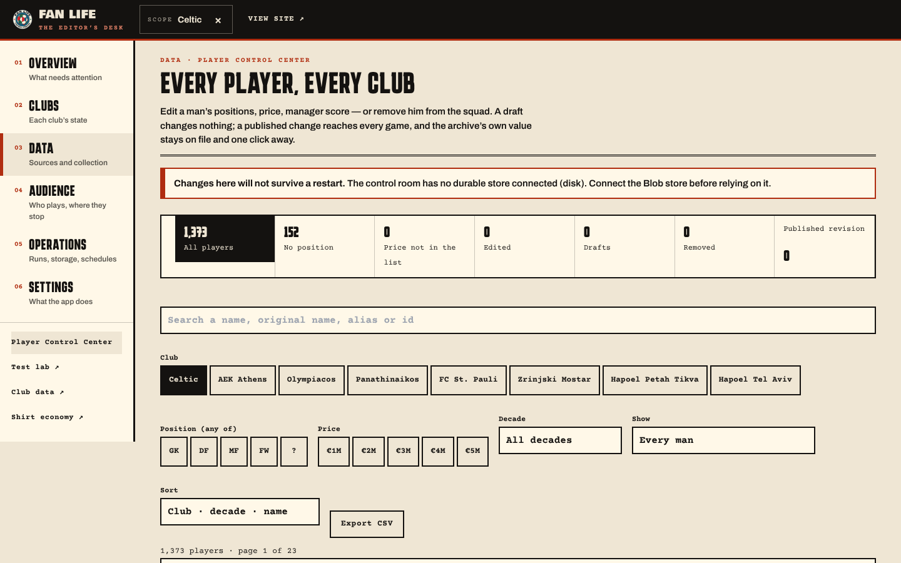
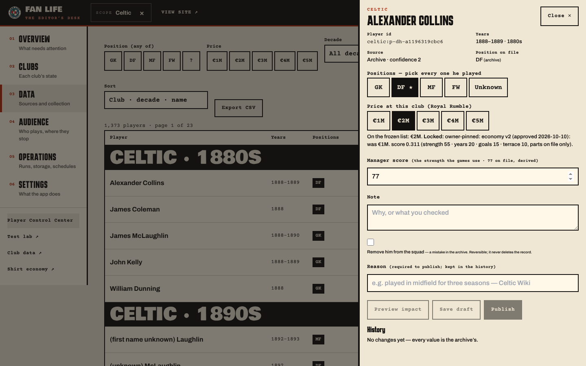
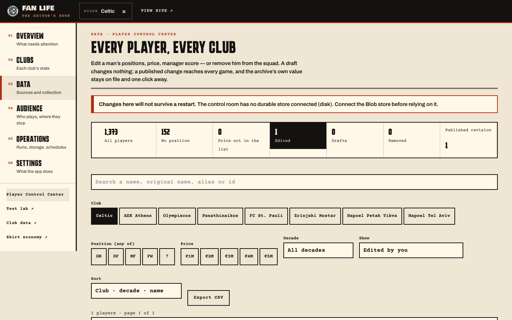
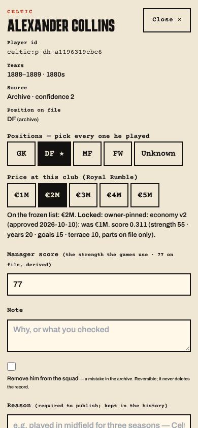

# Player Control Center — user guide

**Where:** FAN LIFE control room → **Data** → *Player Control Center* (sidebar, left), or `/master/admin?section=data&view=players`. Sign-in is the usual owner key.

   

## Find a man
Pick clubs (chips), a **decade** or *Years not recorded*, positions (any of GK/DF/MF/FW, `?` = no position on record), prices €1–€5M, or *Show* → no position · price not in the frozen list · edited by you · has a draft · removed · locked · roster-wave (unreviewed) · archive proper. Search matches the English name, the original name (Hebrew/Greek), aliases and the id. The list is grouped **club → decade** and paged on the server. **Export CSV** takes the current filters.

## Edit a man — click *Edit*
* **Positions:** tick every position he played. The first is primary (★, any other can be made primary); the others are secondary — he fits a slot of any of them. *Unknown* is a real answer: he is then dealt into any outfield slot, never in goal.
* **Price at this club:** €1–€5M. The frozen list value is shown underneath.
* **Manager score:** 40–99, the hidden strength the games use; the archive's value and its basis (individual / club baseline / derived) are shown. Price and score are independent.
* **Remove him from the squad:** for a mistake in the archive. Needs a second tick; reversible; the record is never deleted.
* **Preview impact** shows what the change reaches, whether the club leaves its price ladder (then *Publish as an exception* must be ticked), and whether any game stops being ready. A **pinned/locked** price needs *Owner exception*.
* **Save draft** keeps it private — the games ignore drafts. **Publish** (a reason is required) makes it live in every game within seconds; **Discard draft** drops it.
* **History** lists every change (who, when, why). *Revert this change* puts the man back — as a new entry; nothing is erased.

## If two people edit at once
The second publish is refused with *"changed by someone else"* — reopen the player and decide again. Nothing is overwritten silently.

## Storage
If the page says *Changes here will not survive a restart*, no durable store is connected (Vercel Blob). Connect it before using the desk for real work.
